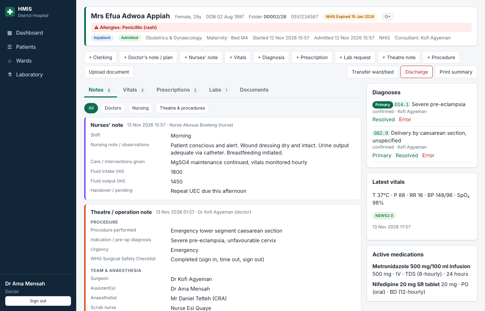

# HMIS: a lean hospital information system for Ghana

A hospital information management system for district and regional hospitals and polyclinics. It covers the clinical core: outpatients and inpatients, history and examination, ICD-10 diagnoses with G-DRG mapping, nurses' notes, doctors' plans, lab requests and results, scanned documents and theatre notes. It leaves out the rest.

* **No dependencies.** It runs on Node.js 22 alone, using the built-in `node:http` and `node:sqlite` modules. There is no `npm install`, no database server and no build step.
* **One folder holds all data** (`data/`): a SQLite database plus the uploaded files. Backups are a single command.
* **It works in any modern browser**, on a desktop, a ward tablet or a phone, and can photograph documents straight from a phone camera.



## Features

| Area | What it does |
|---|---|
| **Registration** | Demographics, auto folder number (`00001/26`, or keep the existing paper folder number), **Ghana Card** (format checked), **NHIS** number and expiry (expired cover is flagged on every screen), GhanaPost GPS, region, next of kin, allergies. Estimated DOB from age. |
| **Outpatient (OPD)** | Start a visit by department and payer (NHIS, cash, insurance). Clinic queue on the dashboard, filtered by department. |
| **Emergency and inpatient (IPD)** | Admit from OPD or directly, choose ward and bed, transfer, bed board per ward with occupancy and NEWS2, discharge with outcome (Discharged, Referred, DAMA, Absconded, Died). |
| **History and examination** | Structured clerking: presenting complaint, HPC, ROS, PMH, PSH, obstetric/gynae history, drug history (incl. herbal medicines), family and social history, systemic exam, impression and plan. |
| **Doctor's notes and plan** | SOAP progress notes, bedside procedure notes. |
| **Nurses' notes** | Shift notes, care given, fluid intake and output, handover. |
| **Vital signs** | T, P, RR, BP, SpO₂ (on O₂), AVPU, weight, height, BMI, MUAC, glucose, pain. **NEWS2** is calculated automatically for adults, with an alert at 5 or more. |
| **Diagnosis** | **ICD-10** search by code or words, primary or secondary, provisional, confirmed or differential, resolved, "entered in error". A **G-DRG** code is carried for NHIS claims. |
| **Prescriptions** | Drug, dose, route, frequency and duration, with a quick-pick list from the Ghana Essential Medicines List. Stop or complete. |
| **Laboratory** | Request tests (routine, urgent, STAT) with clinical information. Lab worklist: collect sample, enter results, automatic **H/L/abnormal flags** against reference ranges, reject, correct (audited). Cumulative results on the patient chart. 29 tests preloaded (FBC, MRDT, BF for MPs, FBS/RBS/HbA1c, U&E/Cr, LFT, lipids, urinalysis, stool R/E, cultures, AFB, GeneXpert, HIV, HBsAg, HCV, syphilis, Widal, hCG, sickling, Hb electrophoresis, GXM, G6PD, ESR, CRP, PSA, TFT). |
| **Theatre** | Operation note with the **WHO Surgical Safety Checklist**, team, anaesthesia type, ASA class, times, findings, procedure, estimated blood loss, swab counts, specimens, complications and post-op orders. |
| **Scanned documents** | Upload PDF or images (old folders, referral letters, external reports, consent forms, anaesthesia charts) to the patient or a visit. They open in the browser. File type is checked against the file contents and a SHA-256 hash is kept for integrity. |
| **Printing** | Discharge or clinical summary of any encounter (diagnoses, medications, results, notes), ready to print. |
| **Interoperability** | **HL7 FHIR R4** export per patient (Patient, Encounter, Condition coded in ICD-10, Observation coded in LOINC). |
| **Security and medico-legal** | Role-based access, append-only notes (an amendment keeps and supersedes the original), full **audit trail** including who viewed each chart, scrypt password hashing, forced password change, session timeout, login lockout, CSRF protection and a strict Content Security Policy. |

### Roles

| Role | Can do |
|---|---|
| `doctor` | Everything clinical: notes, diagnoses, prescriptions, labs, theatre notes, admit and discharge |
| `nurse` | Register patients, vitals, nurses' notes, request labs, admit or transfer, upload documents. Read doctors' notes. |
| `lab` | Lab worklist: collect, result, reject. Sees patient identity only, no clinical notes. |
| `records` | Register and edit patients, open visits, upload scanned documents. No clinical notes. |
| `admin` | All of the above plus users, wards, lab catalogue, ICD-10/G-DRG import, settings and the audit log |

## Quick start

Requires **Node.js 22.13 or newer**. Nothing else.

```bash
git clone <this repo> hmis && cd hmis
npm start
```

On first start the console prints a one-time `admin` password. Open http://localhost:3000, sign in, set a new password, then create staff accounts under **Administration → Users**.

To try it with sample patients and staff (password `Demo1234` for `doctor`, `surgeon`, `nurse`, `lab`, `records`):

```bash
npm run demo     # only on a test install, never on a live system
npm start
```

### Configuration (environment variables)

| Variable | Default | Purpose |
|---|---|---|
| `PORT` | `3000` | HTTP port |
| `HOST` | `0.0.0.0` | Bind address |
| `HMIS_DATA_DIR` | `./data` | Database and uploaded documents |
| `HMIS_ADMIN_PASSWORD` | random | Initial admin password (first run only) |
| `HMIS_SECURE_COOKIES` | off | Set to `1` when served over HTTPS |

## Before going live

1. **G-DRG mapping.** The system ships with about 120 common ICD-10 codes for Ghanaian OPDs and wards. Under **Administration → ICD-10 / G-DRG**, import a CSV (`code,title,gdrg_code`) holding the full WHO ICD-10 list and the G-DRG codes from the **current NHIA tariff**. G-DRG codes are not bundled because they change with each tariff revision and must match the one in force.
2. **Lab reference ranges.** The preloaded ranges are generic adult values in SI units. Have the laboratory replace them with its own validated intervals (**Administration → Lab tests**). Check the LOINC codes there too if you exchange data with other systems.
3. **Wards and beds.** Edit them to match your facility, and set the facility name under **Settings**.
4. **HTTPS.** On a hospital network, put the app behind a reverse proxy with TLS (e.g. Caddy or nginx) and set `HMIS_SECURE_COOKIES=1`.
5. **Run as a service**, e.g. with systemd:
   ```ini
   [Service]
   WorkingDirectory=/opt/hmis
   ExecStart=/usr/bin/npm start
   Environment=HMIS_DATA_DIR=/var/lib/hmis
   Restart=always
   User=hmis
   ```
6. **Backups.** `npm run backup` writes a consistent copy of the live database and all documents to `backups/<timestamp>/`. Schedule it nightly (cron) and copy the backups off the server.
7. **Data protection.** Register with the Data Protection Commission as the Data Protection Act, 2012 (Act 843) requires. Only give accounts to staff who need them, and review the audit log.

## Project layout

```
server.js            entry point
lib/db.js            SQLite schema and migrations
lib/auth.js          passwords, sessions, role permissions
lib/clinical.js      note templates, NEWS2, lab flagging, Ghana reference lists
lib/seed.js          ICD-10 starter set, lab catalogue, wards
lib/routes.js        REST API
lib/app.js           HTTP layer, static files, security headers
public/              browser app (plain ES modules, no build)
scripts/             demo data, backup
test/                end-to-end API tests  (npm test)
```

## Development

```bash
npm test    # spins up the server with a temporary database and runs the workflow tests
```

Note templates (clerking, SOAP, nursing, theatre, procedure) are defined once in `lib/clinical.js`. The server validates against them and the browser builds its forms from them, so adding a field means editing one file.
